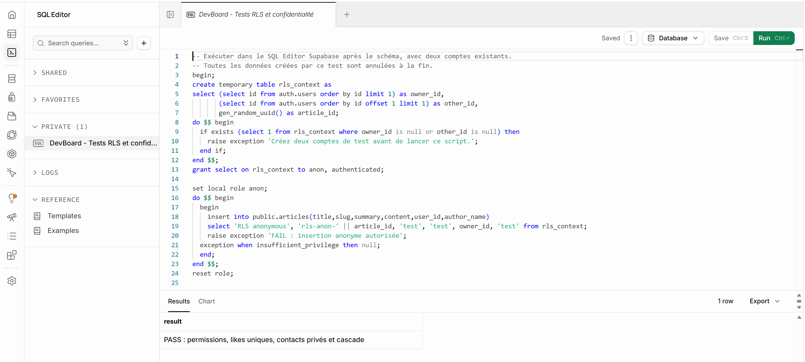
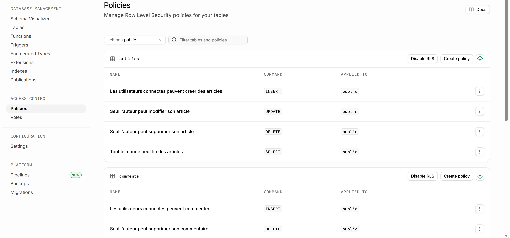

# Verification de DevBoard - 1 novembre 2026

## Site de production

Essais realises sur https://ece-webtech-302.vercel.app, avec le compte de Kardiatou. Ils concernent la version de production, pas une preuve du deploiement des corrections de la branche.

| Controle | Resultat | Preuve / limite |
|---|---|---|
| Session connectee | Observee | Email et bouton Deconnexion visibles dans le menu |
| Creation d'article | Reussie | Article dedie Test Kardiatou visible dans la liste |
| Lecture et modification | Reussies | Nouveau titre visible sur la page de detail |
| Like et commentaire | Affiches | Compteur et commentaire visibles ; conservation et retrait du like confirmes par l'utilisatrice |
| Suppression de l'article de test | Reussie | Absent de la liste apres actualisation |
| Nettoyage dans Supabase | Aucune ligne visible restante | Requetes publiques pour l'article, ses commentaires et likes : HTTP 200 et listes vides. Ne remplace pas un controle administrateur des lignes masquees par RLS |
| Recherche Tailwind | Reussie | Article Tailwind CSS 4 retrouve |
| Filtre Backend | Reussi | Article de categorie Backend affiche |
| Recherche Tailwind + Backend | Reussie | Aucun article trouve, sans contenu de remplacement |
| Reinitialisation des filtres | Reussie | Retour a la liste complete |
| Contact : champs obligatoires | Verifies | Nom, email, objet et message obligatoires |
| Contact : email invalide | Verifie | Une adresse mal formee est signalee invalide par le navigateur |
| Contact : envoi et stockage | Non testes | Aucun message envoye pendant ces essais |
| Affichage mobile | Verifie a 390 x 844 | Articles et contact lisibles, sans debordement horizontal observe |
| Menu mobile | Verifie | Ouverture et fermeture apres navigation vers Contact et Articles |

## Branche de corrections

Proposition : https://github.com/ivanfocsa/ece-webtech-302/pull/1

- Dernieres evolutions du groupe integrees sans modifier main.
- Compilation de production reussie apres integration, avec configuration Supabase locale.
- Tests JavaScript : reponses Supabase simulees ; ils ne prouvent pas les permissions de la base distante.
- GitHub signale le deploiement Vercel de la branche comme reussi ; cela ne valide pas a lui seul tous les parcours utilisateurs.

## Verification Supabase du 3 novembre 2026

L'acces au projet du groupe est actif pour le compte Kardiatou. Les quatre tables ont RLS active.

### Confidentialite des contacts appliquee

La politique SELECT historique de public.contacts a ete modifiee et renommee depuis le dashboard :

```sql
using ((auth.jwt() -> 'app_metadata' ->> 'role') = 'admin')
```

L'operation INSERT publique reste autorisee. Aucun message existant n'a ete supprime. La modification a ete faite depuis l'interface et non par execution du fichier de migration : la migration reste disponible pour reproduire la configuration (elle cible explicitement authenticated). Les administrateurs du projet peuvent toujours consulter les messages via leurs outils autorises. Aucun role admin n'a ete attribue a un utilisateur.

### Tests SQL sur la base reelle : PASS

Le script supabase/tests/rls_test.sql a ete execute dans le dashboard. Il utilise deux comptes existants, simule leurs contextes JWT avec SET LOCAL ROLE et verifie :

- insertion d'article anonyme refusee ;
- creation et modification par le proprietaire autorisees ;
- modification et suppression de l'article par un tiers sans effet ;
- ajout autorise de commentaire et de like ;
- doublon de like refuse ;
- commentaire avec identite d'auteur usurpee refuse ;
- contact inserable par un visiteur, invisible aux visiteurs et comptes ordinaires ;
- contact visible avec un contexte admin simule ;
- suppression par le proprietaire et cascade sur commentaires et likes.

Resultat final : `PASS : permissions, likes uniques, contacts prives et cascade` (accents presents dans la sortie originale).
La transaction se termine par ROLLBACK : aucune donnee de test n'est conservee. Ce test valide les politiques avec les roles applicatifs dans PostgreSQL ; il ne remplace pas deux parcours navigateur connectes separement.





### Connexion locale : limitation de permissions

Le dashboard contient seulement les retours Vercel (`https://ece-webtech-302.vercel.app/**` et `/auth/callback`). L'adresse locale `http://localhost:3001/auth/callback` est absente. Le bouton Add URL et le champ Site URL sont desactives pour ce compte. Un responsable disposant des droits Authentication doit ajouter l'adresse locale sans supprimer les retours Vercel. Aucune tentative de contournement des droits.

## Encore necessaire

1. Ajouter le retour localhost dans Supabase avec un compte autorise, puis tester completement OAuth en local.
2. Si souhaite, faire un essai de permissions avec deux navigateurs/comptes distincts pour completer le test SQL deja reussi.
3. Verifier l'envoi du formulaire Contact depuis le navigateur et son stockage. Le test SQL d'insertion fonctionne ; aucun message reel n'a ete envoye via le formulaire.
4. Valider la proposition GitHub avant fusion et verifier le deploiement final.
